# Driftsdokumentasjon: Fjerntilgang til Windows-PC med SSH

**Fag:** Driftsstøtte / Brukerstøtte
**Skrevet av:** Stas
**Klasse:** 2IMV
**Dato:** 19.11.2026

## 1. Mål med prosjektet

Jeg ville sette opp sikker fjerntilgang til PC-en min hjemme. Målet var at jeg kan logge inn på PC-en fra mobilen og kjøre kommandoer, uten å sitte ved PC-en. Jeg ville også sjekke at trafikken er kryptert, og at bare enheter i mitt eget nettverk får koble til.

## 2. Utstyr og miljø

| | |
|---|---|
| Server (PC som fjernstyres) | Stasjonær PC, Windows 11 Home, navn: Stas, IP: 192.168.0.207 |
| Klient | Android-mobil med appen Termux, IP: 192.168.0.191 |
| Nettverk | Hjemmenettverk på Wi-Fi, subnett 192.168.0.0/24, ruter TP-Link 192.168.0.1 |
| Verktøy | Windows PowerShell (som administrator), OpenSSH Server, Wireshark 4.2.6 |

## 3. Hvorfor SSH og ikke Remote Desktop

Først tenkte jeg å bruke Remote Desktop (RDP), slik det står i kompendiet. Men PC-en min har Windows 11 Home. Home-versjonen kan ikke ta imot RDP-tilkoblinger. Tjenesten TermService finnes på maskinen, men server-delen er slått av i Home.

Derfor valgte jeg SSH. SSH fungerer på alle versjoner av Windows. Trafikken er kryptert, og SSH bruker port 22. Forskjellen er at SSH er tekstbasert, mens RDP viser skjermen grafisk. For å kjøre kommandoer er SSH nok.

## 4. Framgangsmåte

### Steg 1. Installere OpenSSH Server

Jeg gikk til Innstillinger → System → Valgfrie funksjoner → Vis tilgjengelige funksjoner. Der søkte jeg på «OpenSSH» og valgte «OpenSSH Server». Installasjonen tok noen minutter.

Resultat: Tjenesten `sshd` ble lagt til på maskinen.

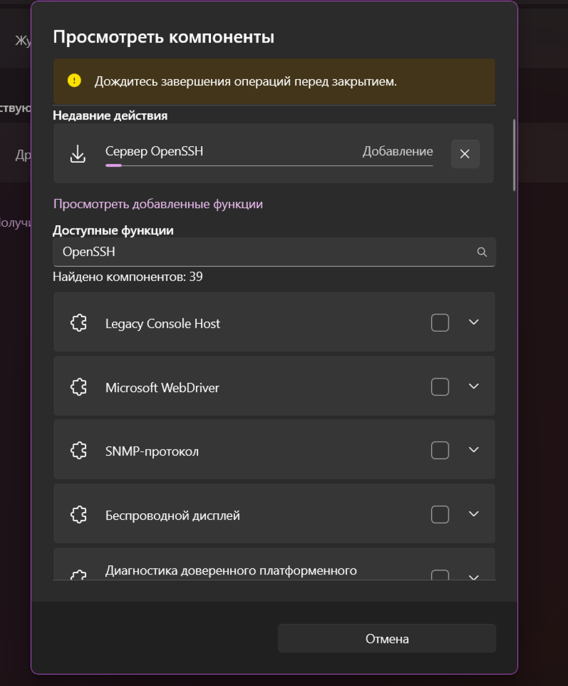

### Steg 2. Starte tjenesten

Jeg åpnet PowerShell som administrator og kjørte:

```powershell
Start-Service sshd
Set-Service -Name sshd -StartupType Automatic
Get-Service sshd
```

`Set-Service` med `Automatic` betyr at SSH starter av seg selv når PC-en starter.

Resultat: Status `Running`, DisplayName «OpenSSH SSH Server».

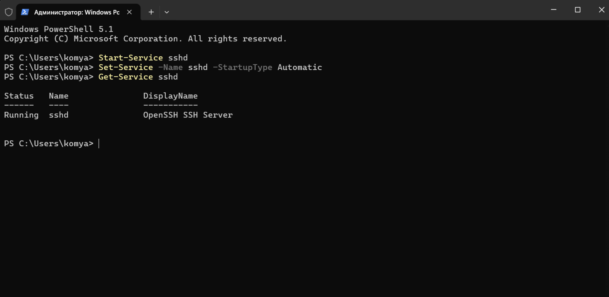

### Steg 3. Åpne port 22 i brannmuren

```powershell
New-NetFirewallRule -DisplayName "Allow SSH Port 22" -Direction Inbound -Protocol TCP -LocalPort 22 -RemoteAddress 192.168.0.0/24 -Action Allow
```

Jeg brukte `-RemoteAddress 192.168.0.0/24`. Det betyr at bare maskiner i hjemmenettverket får bruke regelen. Maskiner fra internett blir stoppet.

Kontroll:

```powershell
Get-NetFirewallRule -DisplayName "Allow SSH Port 22" | Format-Table DisplayName, Enabled, Direction, Action
```

Resultat: Enabled `True`, Direction `Inbound`, Action `Allow`.

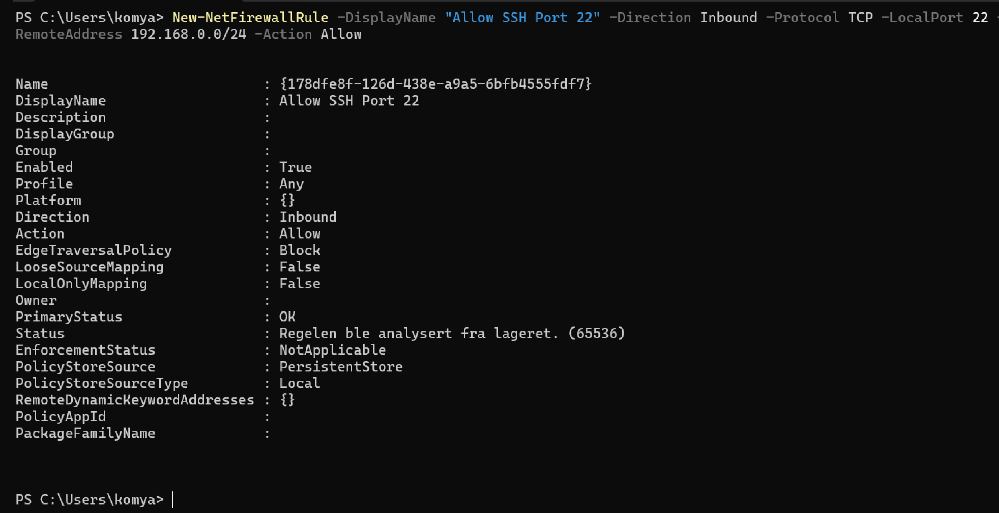

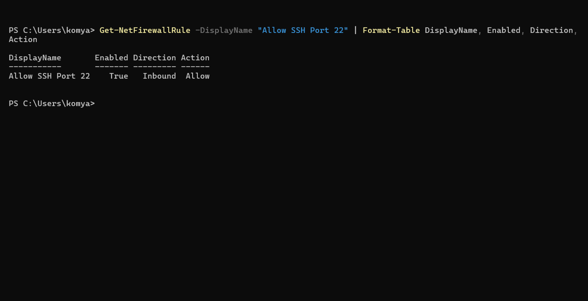

### Steg 4. Sjekke at SSH lytter på port 22

```powershell
Get-NetTCPConnection -LocalPort 22 -State Listen
```

Resultat: To linjer med `Listen`. En for IPv4 (0.0.0.0) og en for IPv6 (::). Det betyr at serveren venter på tilkoblinger på port 22.

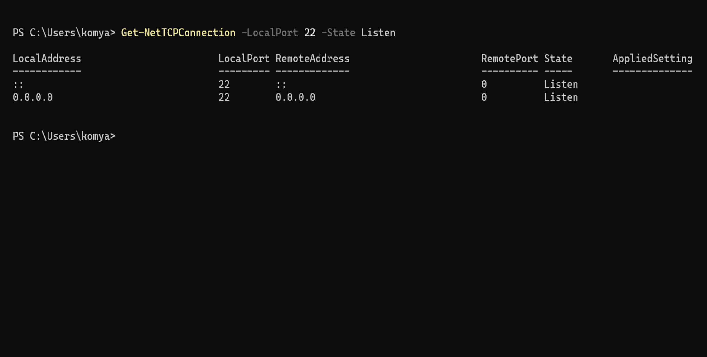

### Steg 5. Tillate ping bare fra lokalnettet

Ping bruker ICMP, ikke TCP eller UDP. Derfor må man lage en egen regel for ICMP, ikke åpne en port.

```powershell
New-NetFirewallRule -DisplayName "Allow Ping from LAN" -Direction Inbound -Protocol ICMPv4 -IcmpType 8 -RemoteAddress 192.168.0.0/24 -Action Allow
```

Kontroll:

```powershell
Get-NetFirewallRule -DisplayName "Allow Ping from LAN" | Get-NetFirewallAddressFilter
```

Resultat: RemoteAddress `192.168.0.0/255.255.255.0`. Regelen gjelder bare for lokalnettet.

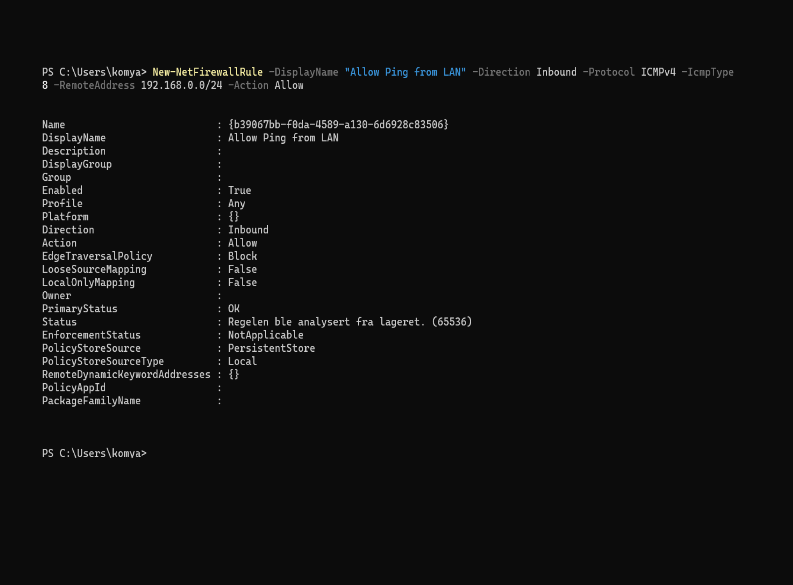

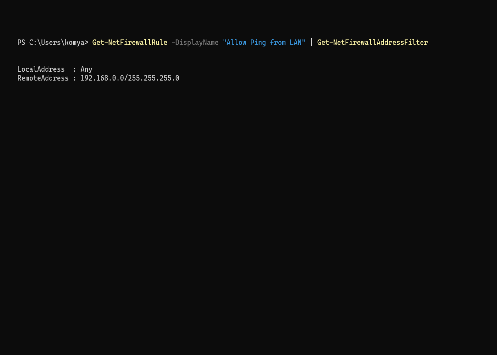

### Steg 6. Lage en egen bruker for SSH

Min vanlige bruker på PC-en er koblet til en Microsoft-konto. Da fungerer ikke PIN-koden for SSH, og jeg ville ikke bruke Microsoft-passordet mitt til fjerntilgang. Derfor laget jeg en egen lokal bruker:

```powershell
New-LocalUser -Name "sshbruker" -FullName "SSH-bruker" -Description "Bruker for fjerntilgang via SSH"
```

Dette er også bedre for sikkerheten. Hvis noen finner passordet til `sshbruker`, får de ikke tilgang til hovedkontoen min.

### Steg 7. Koble til fra mobilen

På mobilen installerte jeg Termux og SSH-klienten:

```
pkg install openssh
ssh sshbruker@192.168.0.207
```

Første gang spurte Termux om «fingerprint». Jeg svarte `yes`. Så skrev jeg passordet til `sshbruker`.

Resultat: Jeg kom inn og fikk `sshbruker@STAS C:\Users\sshbruker>`. Jeg kjørte `hostname` (svar: Stas), `whoami` (svar: stas\sshbruker) og `ipconfig` (viste IPv4 192.168.0.207).

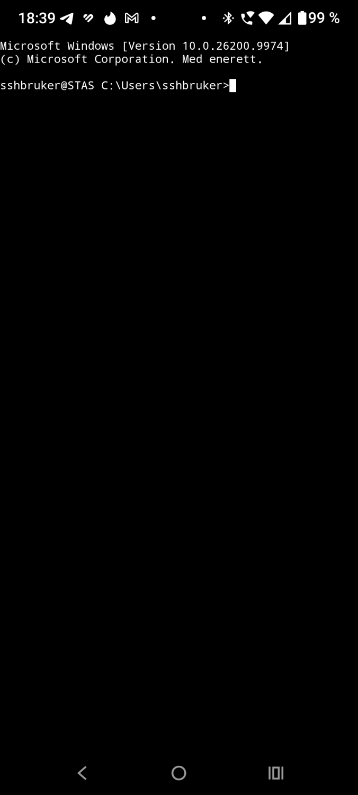

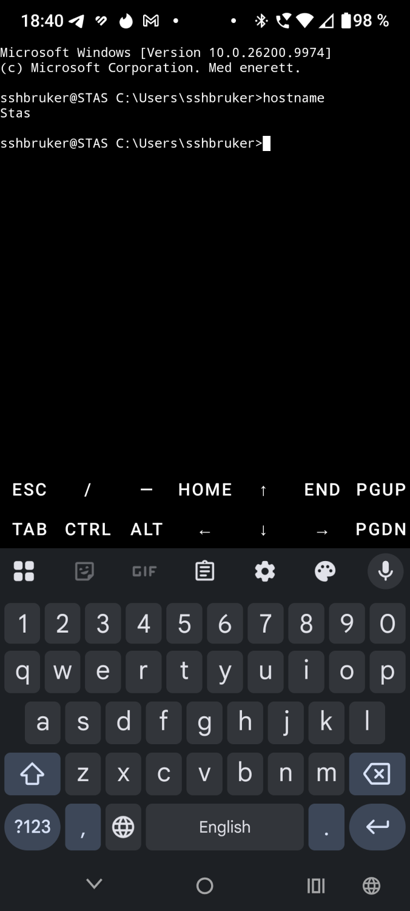

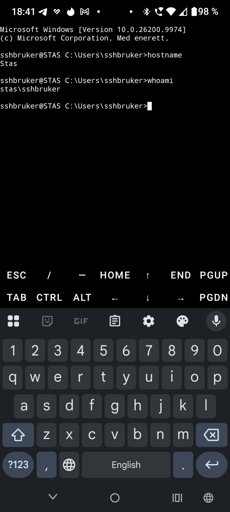

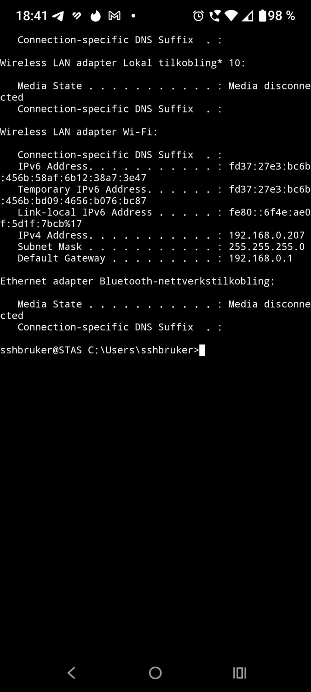

På PC-en sjekket jeg samtidig at tilkoblingen var aktiv:

```powershell
Get-NetTCPConnection -LocalPort 22 -State Established
```

Resultat: LocalAddress 192.168.0.207, port 22, RemoteAddress 192.168.0.191 (mobilen), State `Established`.

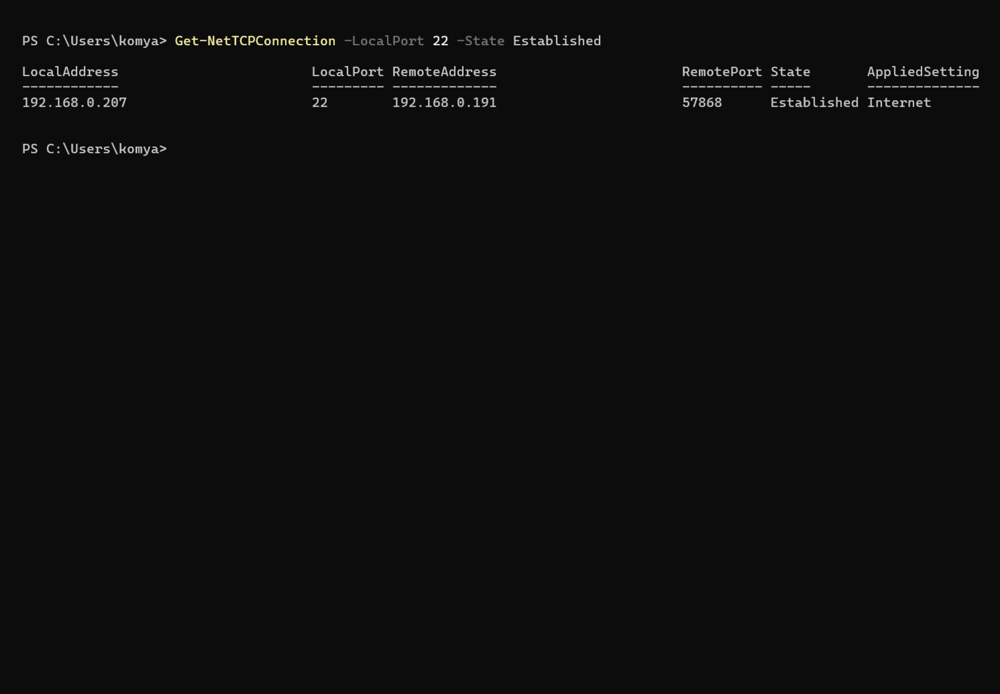

### Steg 8. Analysere trafikken i Wireshark

Jeg installerte Wireshark og startet opptak på Wi-Fi. Mens opptaket kjørte, logget jeg inn med SSH fra mobilen og kjørte ping fra mobilen.

| Filter | Hva jeg så |
|---|---|
| `tcp.port == 22` | Mange pakker mellom 192.168.0.191 og 192.168.0.207. Alle står som «Client: Encrypted packet» eller «Server: Encrypted packet». |
| `icmp` | Fire «Echo (ping) request» fra mobilen (191) til PC (207), og fire «Echo (ping) reply» tilbake. |
| `arp` | «Who has 192.168.0.119? Tell 192.168.0.207» og lignende. ARP viser IPv4-adressene til enhetene i nettverket: ruteren 192.168.0.1, mobilen 192.168.0.191 og flere. |
| `ip` | Bare IPv4-trafikk. IPv6-pakker blir skjult. |

Jeg åpnet også en SSH-pakke i detalj. Innholdet i pakken er bare tilfeldige tegn. Wireshark skriver «Encrypted packet (len=36)». Det betyr at ingen kan lese kommandoene eller passordet mitt i nettverket.

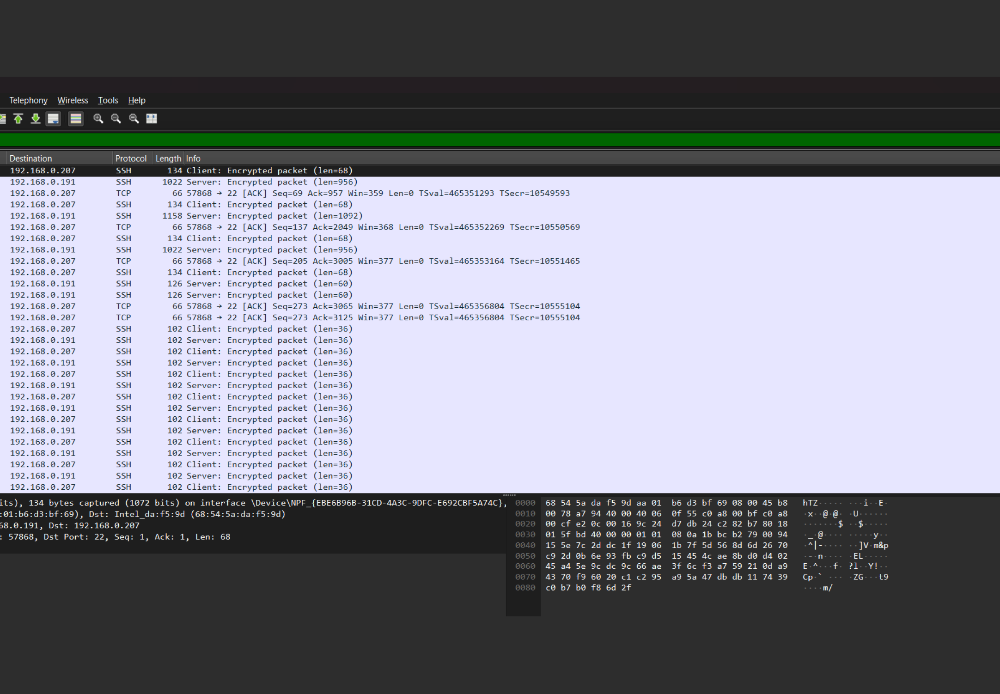

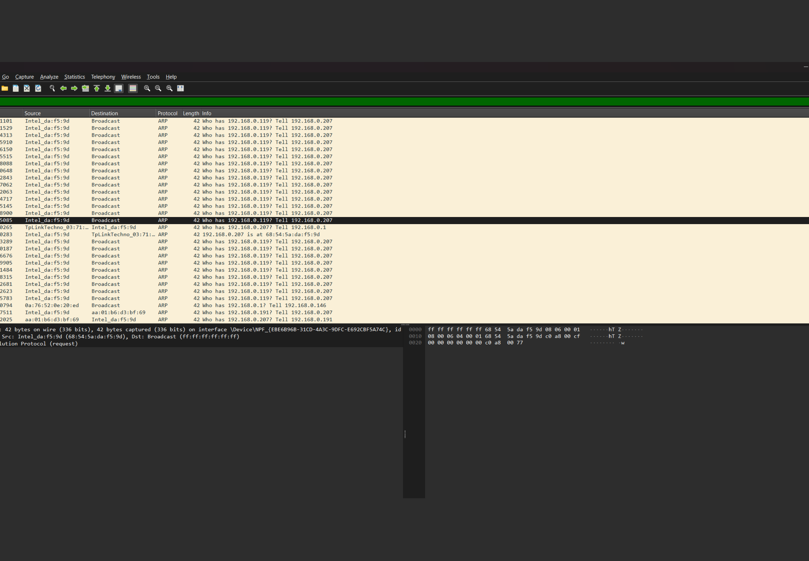

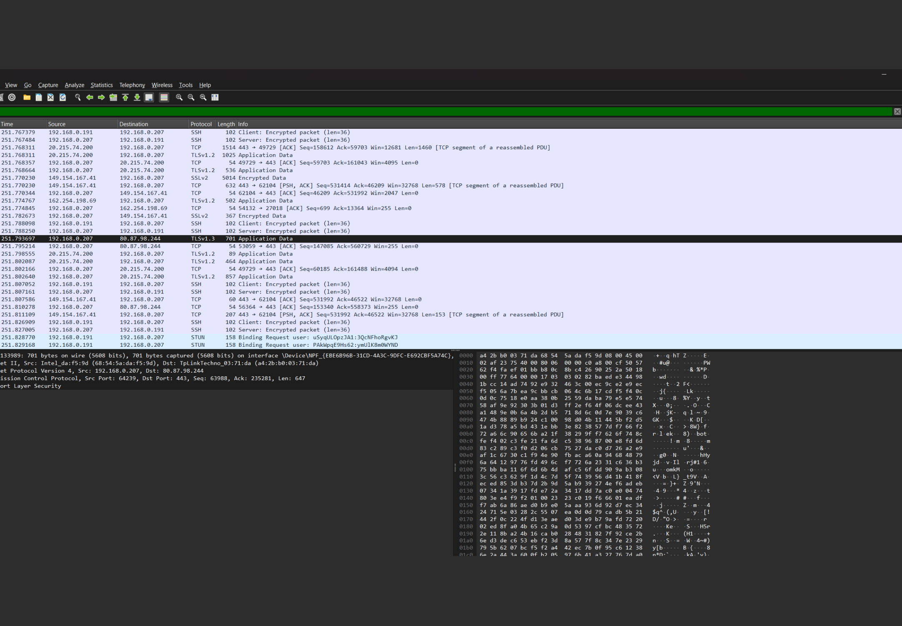

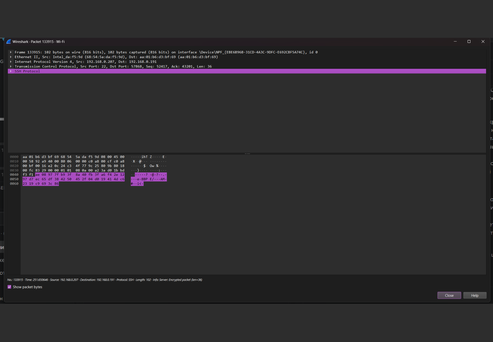

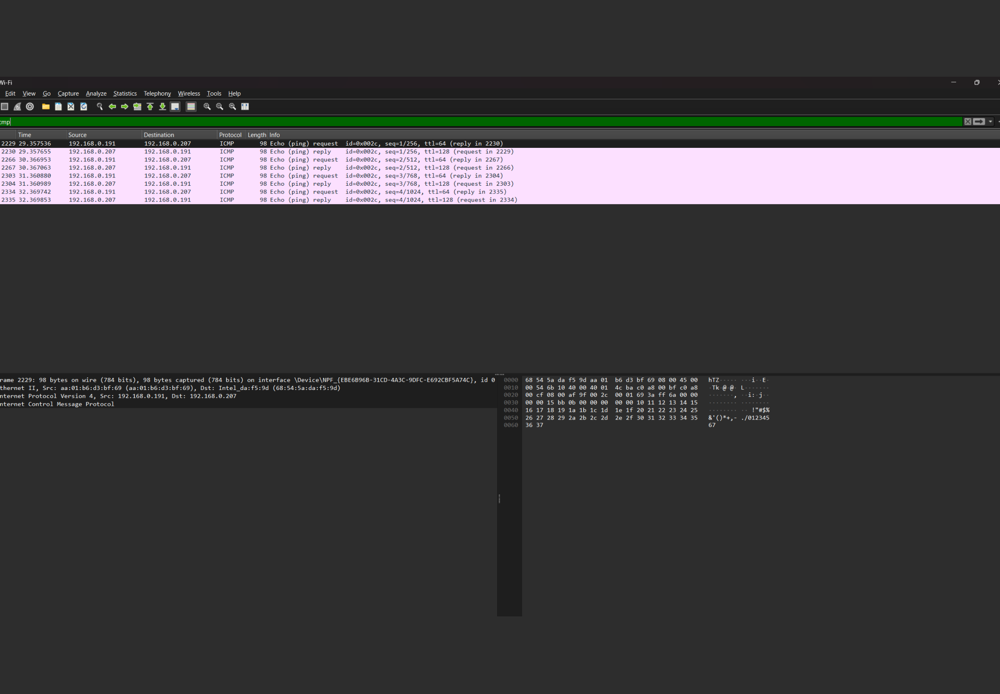

## 5. Testing og resultat

| Test | Forventet | Faktisk | OK |
|---|---|---|---|
| `Get-Service sshd` | Running | Running | Ja |
| Port 22 lytter | State Listen | Listen på IPv4 og IPv6 | Ja |
| SSH fra mobil i lokalnettet | Innlogget | Innlogget som sshbruker | Ja |
| Aktiv forbindelse sett fra server | Established fra 192.168.0.191 | Established fra 192.168.0.191 | Ja |
| Ping fra mobil | 4 svar | 4 sendt, 4 mottatt, 0 tapt | Ja |
| SSH-trafikk kryptert | Encrypted packet | Encrypted packet i Wireshark | Ja |
| SSH fra adresse utenfor 192.168.0.0/24 | Blokkert | Ikke testet, jeg har ikke en maskin utenfor nettverket | – |

## 6. Problemer og løsninger

| Problem | Årsak | Løsning |
|---|---|---|
| Kunne ikke bruke Remote Desktop | Windows 11 Home støtter ikke innkommende RDP | Byttet til SSH, som fungerer på Home |
| Termux: «The program ssh is not installed» | Termux har ikke SSH-klient fra start | `pkg install openssh` |
| «Permission denied» tre ganger ved innlogging | Brukeren komya er en Microsoft-konto. PIN fungerer ikke for SSH | Laget en lokal bruker `sshbruker` med eget passord |
| Windows laget selv en regel «OpenSSH SSH Server (sshd)» som åpnet port 22 for alle adresser | Regelen lages automatisk når man installerer OpenSSH Server | Begrenset regelen med `Set-NetFirewallRule -DisplayName "OpenSSH SSH Server (sshd)" -RemoteAddress 192.168.0.0/24`. Hvis ikke, hadde min egen regel ingen effekt, fordi den åpne regelen slapp alt gjennom |
| Filteret `icmp` i Wireshark viste bare «Port unreachable», ingen ping | Jeg kjørte `ping` inne i SSH-økten. Da pinget PC-en seg selv, ikke fra mobilen | Gikk ut av SSH med `exit` og kjørte `ping -c 4 192.168.0.207` direkte i Termux. Da kom Echo request og reply |

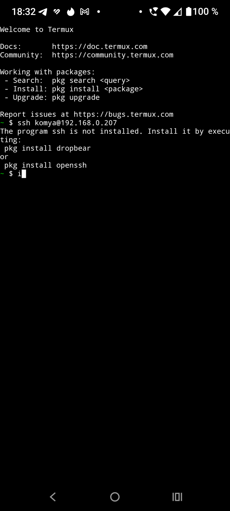

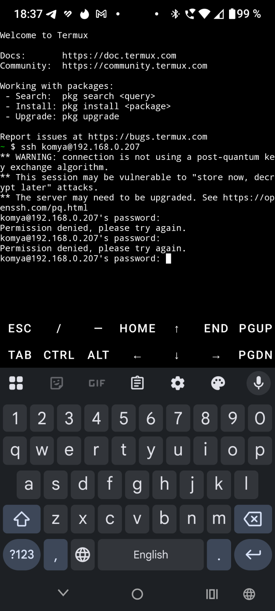

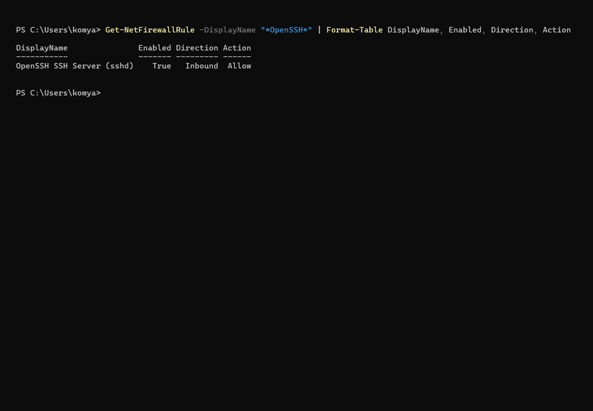

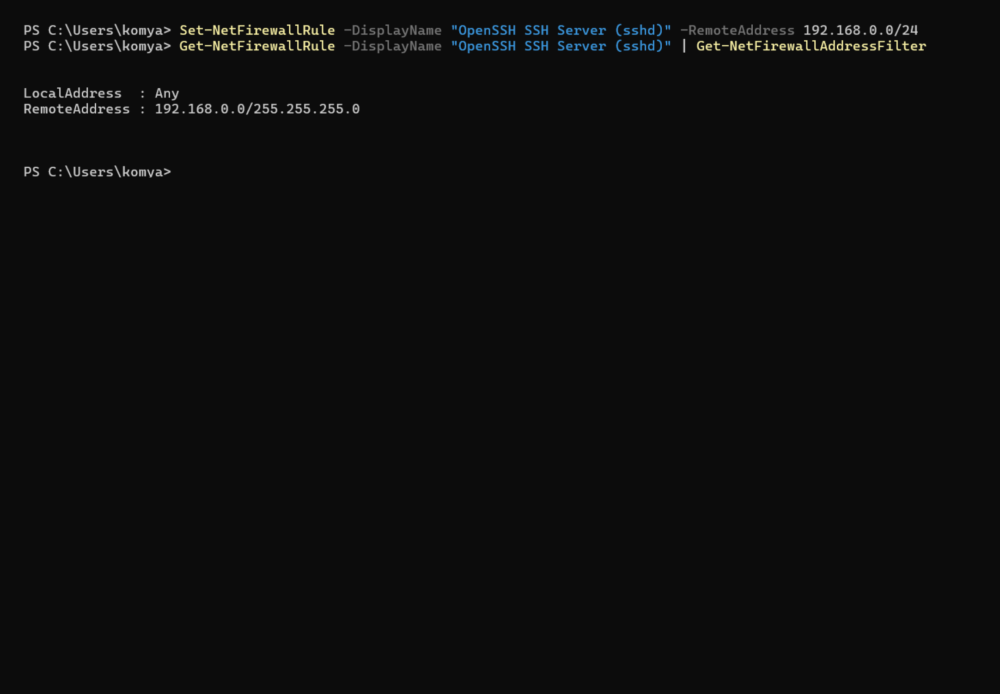

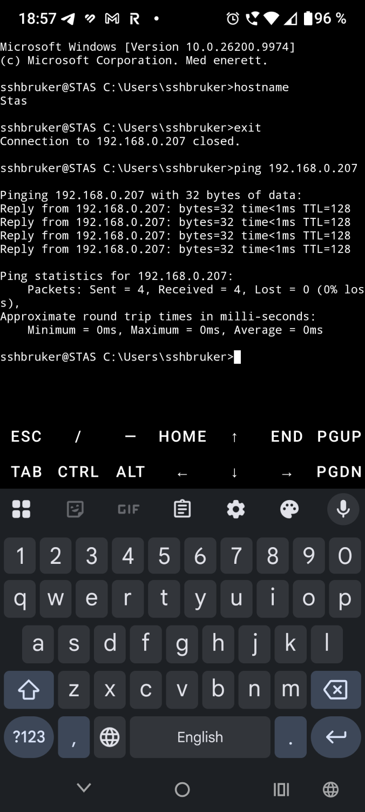

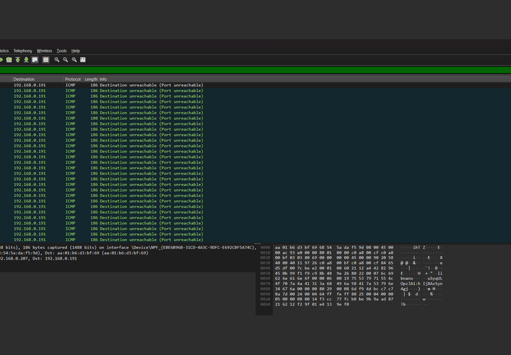

## 7. Sikkerhet

- SSH krypterer all trafikk. Jeg så i Wireshark at pakkene ikke kan leses.
- Begge brannmurreglene for port 22 er begrenset til 192.168.0.0/24. Maskiner fra internett kommer ikke inn.
- Ping er også begrenset til lokalnettet. Da kan ikke noen utenfra sjekke om PC-en er på.
- Jeg bruker en egen bruker `sshbruker` for fjerntilgang, ikke hovedkontoen min.
- Port 22 er ikke åpnet i ruteren. Tilgangen fungerer bare hjemme.
- Neste steg kan være å bruke SSH-nøkkel i stedet for passord. Da er det enda vanskeligere å gjette seg inn.

## 8. Kilder

- Rasmussen, P. (2026). *Windows PowerShell, Konfigurere firewall, remote desktop og SSH*, versjon 4-1.
- Rasmussen, P. (2026). *Wireshark, kun å vise IPv4-adresser*, versjon 1.
- Microsoft Learn. *Get started with OpenSSH for Windows*. https://learn.microsoft.com/windows-server/administration/openssh/openssh_install_firstuse
- Cisco Networking Academy. *Networking Basics*.
- Termux Wiki. *Remote Access*. https://wiki.termux.com/wiki/Remote_Access
